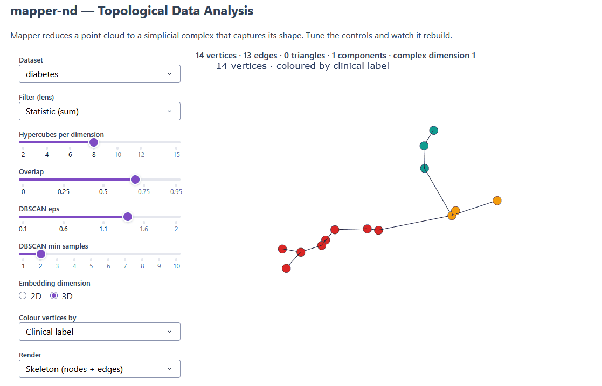
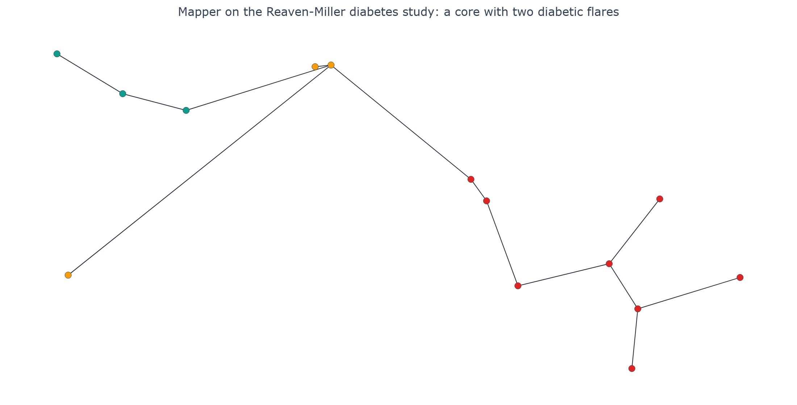

# mapper-nd

[](https://github.com/mrr97/mapper-nd/actions/workflows/ci.yml)
[](LICENSE)


Mapper turns a dataset with many measurements per observation into a map of related groups. Each node represents a group of similar observations; connections show where groups share members. This helps explore whether the data forms separate populations, branching patterns or loops, and how those structures change with the analysis settings.

This project implements the algorithm from scratch, with an interactive app and examples ranging from geometric shapes to patient measurements. Its core supports filters in any dimension and records intersections between several groups as triangles, tetrahedra and higher-dimensional structures. The app lets you inspect the result in 2D or 3D and adjust the grouping parameters.

## Demo



The Dash app opens on the diabetes dataset, coloured by clinical group. You can switch datasets, adjust the filter, cover and clustering settings, and rotate the result. Rendering options show the skeleton (nodes and edges), surfaces (including triangles) or solid structures (including tetrahedra).

## Diabetes example

The Reaven–Miller dataset contains 145 adults, each described by five measurements covering relative weight and glucose/insulin values. Mapper groups patients by similarity in those measurements, without using their clinical labels. Each node below represents a group of patients, and an edge means two groups share patients because the analysis uses overlapping regions.



Colours are added afterwards using the majority clinical label in each node: Normal (amber), Chemical Diabetic (teal) and Overt Diabetic (red). With the bundled preset, the map places normal-dominated groups around a junction, with diabetic groups extending in different directions. This shows how measured similarities relate to the existing clinical groups. The `b0=1, b1=0` check confirms connectivity and no independent loops; it does not establish the branch interpretation or measure diagnostic accuracy.

The figure can be regenerated with `uv run python scripts/render_hero.py`.

## How it works

Mapper builds a simplicial complex from a point cloud in four steps:

1. Apply a filter `f: X → Rⁿ` to obtain a view of the data.
2. Cover that view with overlapping hypercubes.
3. Cluster the observations within each hypercube; each cluster becomes a vertex.
4. Connect clusters that share observations. Multiple intersections form triangles, tetrahedra and higher-dimensional simplices, together called the nerve.

The filter can have arbitrary output dimension. Under this hypercube cover, up to `2ⁿ` cover elements can overlap, allowing simplices of dimension up to `2ⁿ − 1`. Available filters include `Projection`, `Eccentricity`, `Statistic` and `GraphLaplacian`.

The library lets you choose the filter, cover and clustering algorithm independently:

```python
from sklearn.cluster import DBSCAN
from mapper_nd.core import Mapper, HypercubeCover, GraphLaplacian
from mapper_nd.datasets import sphere

mapper = Mapper(
    filter=GraphLaplacian(kernel="rbf", n_components=2),
    cover=HypercubeCover(n_intervals=5, overlap=0.5),
    clusterer=DBSCAN(eps=0.4, min_samples=3),
)
result = mapper.fit(sphere(300))
print(result.complex.simplex_counts())
print(result.complex.n_connected_components())
```

The app positions vertices using multidimensional scaling of a Hausdorff-like distance between clusters. Edges are black, triangles blue and tetrahedra red, following the visual convention of the thesis on which the project is based.

## Results and limitations

The repository includes three synthetic point clouds generated from a fixed seed and the Reaven–Miller diabetes dataset, bundled as a CSV.

| Dataset | Points | Input space | Structure explored |
|---|---:|---|---|
| `circle` | 400 | R² | One loop |
| `torus` | 600 | R³ | Two independent loops |
| `sphere` | 400 | R³ | A hollow shell |
| `diabetes` | 145 | R⁵ | A central region with two branches |

Validation computes Betti numbers using simplicial homology over GF(2): `b0` counts connected components, `b1` independent loops and `b2` enclosed voids. The bundled presets produce the following checked values:

| Dataset | Checked Betti numbers | Result |
|---|---|---|
| `circle` | `b0=1, b1=1` | Pass |
| `sphere` | `b0=1, b1=0, b2=1` | Pass |
| `torus` | `b0=1, b1=2` | Pass |
| `diabetes` | `b0=1, b1=0` | Pass |

These checks verify selected properties at tuned presets, rather than full recovery of each dataset's topology for arbitrary parameters. In particular, the torus check covers its two loops but does not require `b2=1`. Sampling density, cover overlap and clustering settings affect the result; the torus generator samples uniformly by surface area.

## Quickstart

With Docker Compose installed:

```bash
docker compose up
```

Docker validates the four bundled presets, then starts the dashboard at http://localhost:8050 if validation succeeds.

### Local development and CLI

With Python 3.12 and uv installed:

```bash
uv sync --dev
uv run mapper-nd validate
uv run mapper-nd dashboard
```

The local dashboard is available at http://127.0.0.1:8050. Use `uv run mapper-nd datasets` to list the bundled datasets.

## Technologies and development

Python 3.12 · NumPy · pandas · scikit-learn · Dash / Plotly · Pydantic · structlog · Typer · Docker Compose

Based on the author's Master's thesis in Mathematics at the University of Málaga (2022).

```bash
uv run pytest
uv run ruff check .
uv run ruff format --check .
```

## Resumen en español

Implementación desde cero del algoritmo Mapper para explorar la estructura de conjuntos de datos. Admite filtros en dimensión arbitraria y construye complejos simpliciales con aristas, triángulos y estructuras de mayor dimensión. Incluye una aplicación interactiva, ejemplos sintéticos y un caso con datos de diabetes. La validación comprueba propiedades topológicas concretas mediante números de Betti.

## License

MIT.
